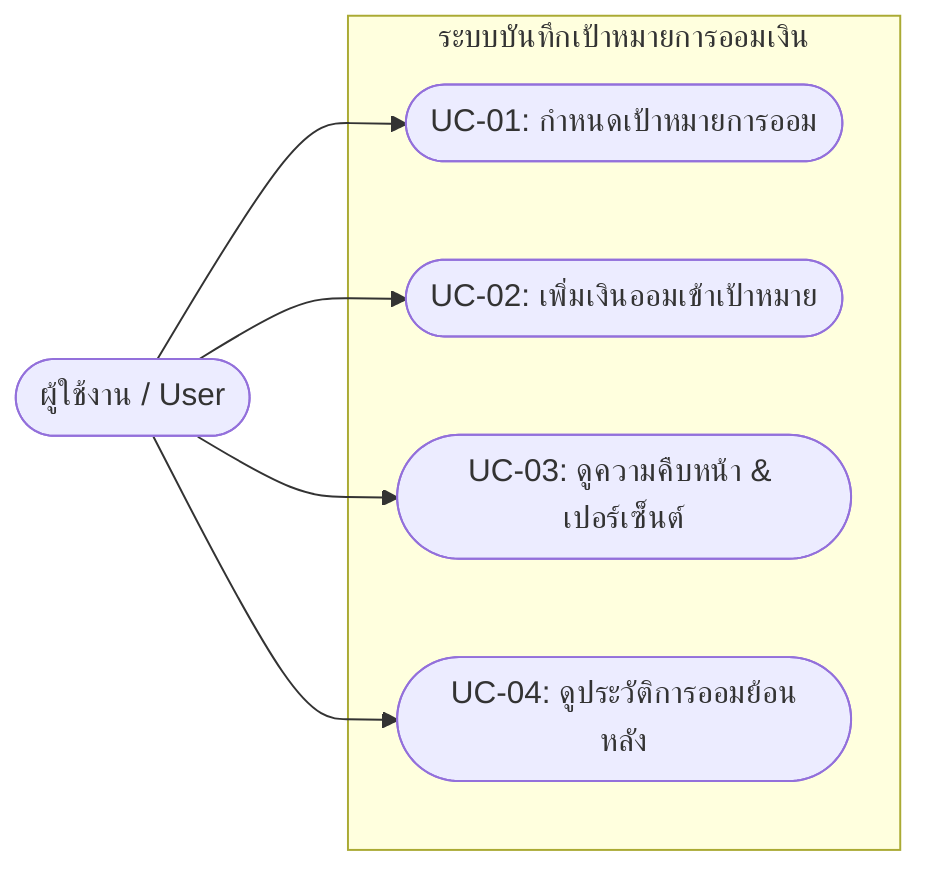
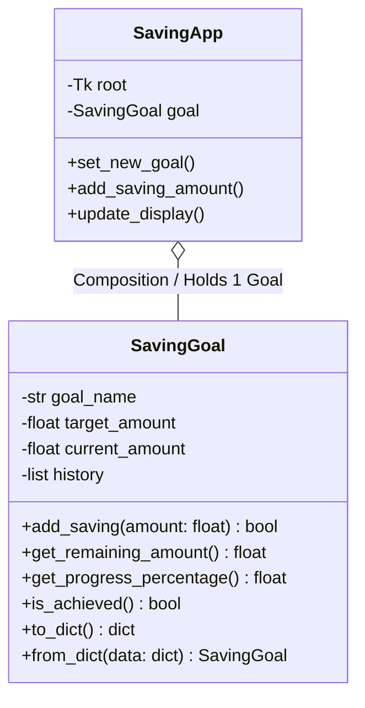

# 💰 มินิโปรเจกต์: ระบบบันทึกเป้าหมายการออมเงิน (Saving Goal App)
**วิชา:** Object-Oriented Analysis and Design (OOAD) & Object-Oriented Programming (OOP)  
**ภาษาและเครื่องมือ:** Python 3, Tkinter GUI, JSON Data Persistence

---

## 1. เอกสารการออกแบบเชิงวิเคราะห์ (OOAD Document)

### 1.1 Problem Statement & วัตถุประสงค์ (Objectives)
* **Problem Statement:** ในชีวิตประจำวัน ผู้คนมักตั้งเป้าหมายทางการเงิน เช่น เก็บเงินซื้ออุปกรณ์การเรียน หรือสะสมเงินทุนสำรอง แต่ขาดเครื่องมือที่เรียบง่ายในการบันทึกและเห็นภาพความก้าวหน้าอย่างชัดเจน ทำให้ขาดแรงจูงใจและลืมติดตามยอดเงินออม
* **วัตถุประสงค์ (Objectives):**
  1. เพื่อสร้างโปรแกรมคอมพิวเตอร์แบบเดสก์ท็อป (Desktop GUI) ที่ช่วยให้ผู้ใช้งานสามารถตั้งเป้าหมายการออมและบันทึกเงินออมได้สะดวกรวดเร็ว
  2. เพื่อนำหลักการวิเคราะห์และออกแบบเชิงวัตถุ (OOAD) และการเขียนโปรแกรมเชิงวัตถุ (OOP) มาประยุกต์ใช้ในการแก้ปัญหาจริง
  3. เพื่อให้ข้อมูลถูกจัดเก็บแบบคงทน (Persistence) ในรูปแบบไฟล์ JSON โดยไม่ต้องติดตั้งระบบฐานข้อมูลภายนอกที่ซับซ้อน

---

### 1.2 ข้อกำหนดฟังก์ชันการทำงาน (Functional Requirements)
ระบบมุ่งเน้นความเรียบง่าย โดยมีฟังก์ชันหลัก 4 ประการ:
1. **FR-01 (เพิ่ม/กำหนดเป้าหมายการออม):** ผู้ใช้สามารถระบุ "ชื่อเป้าหมาย" (Goal Name) และ "จำนวนเงินเป้าหมาย" (Target Amount) ที่มากกว่า 0 บาทได้
2. **FR-02 (เพิ่มเงินออมเข้าเป้าหมาย):** ผู้ใช้สามารถป้อนจำนวนเงินที่ต้องการออมสะสมเพิ่ม (Deposit Amount) โดยระบบจะตรวจสอบค่าต้องมากกว่า 0 บาท และบันทึกเวลาที่ทำรายการอัตโนมัติ
3. **FR-03 (แสดงผลสรุปและเปอร์เซ็นต์):** ระบบจะคำนวณและแสดงผล:
   - ยอดเงินเป้าหมายรวม
   - ยอดเงินที่ออมได้สะสมแล้ว
   - ยอดเงินที่ยังขาดอยู่ (`max(0, target - current)`)
   - เปอร์เซ็นต์ความสำเร็จของการออม (`(current / target) * 100%`) พร้อมแถบ Progress Bar
4. **FR-04 (ดูประวัติการเพิ่มเงินออม):** ผู้ใช้สามารถเรียกดูรายการประวัติการหยอดเงินออมย้อนหลัง พร้อมวัน-เวลาและจำนวนเงินที่ออมในแต่ละครั้ง

---

### 1.3 Use Case Diagram

```text
                  +-------------------------------------------------+
                  |          Saving Goal Application                |
                  |                                                 |
                  |     ( UC-01: กำหนดเป้าหมายการออม )               |
                  |            ^                                    |
                  |            |                                    |
                  |     ( UC-02: เพิ่มเงินออมเข้าเป้าหมาย )          |
                  |            ^                                    |
     [ ผู้ใช้งาน ] |            |                                    |
       (User) ----+----> ( UC-03: ติดตามความคืบหน้าและเปอร์เซ็นต์ ) |
                  |            ^                                    |
                  |            |                                    |
                  |     ( UC-04: ตรวจสอบประวัติการออมเงิน )          |
                  |                                                 |
                  |          <<includes>> โหลด/บันทึกไฟล์ JSON      |
                  +-------------------------------------------------+
```

#### Mermaid Diagram:


---

### 1.4 แผนภาพคลาส (Class Diagram)

```text
+------------------------------------------------------------------+
|                           SavingGoal                             |
+------------------------------------------------------------------+
| - goal_name: str                                                 |
| - target_amount: float                                           |
| - current_amount: float                                          |
| - history: list[dict]                                            |
+------------------------------------------------------------------+
| + __init__(goal_name, target_amount, current_amount, history)    |
| + add_saving(amount: float) -> bool                              |
| + get_remaining_amount() -> float                                |
| + get_progress_percentage() -> float                             |
| + is_achieved() -> bool                                          |
| + to_dict() -> dict                                              |
| + from_dict(data: dict) -> SavingGoal                            |
+------------------------------------------------------------------+
                                 ^
                                 |  1 (holds / uses)
                                 |
+------------------------------------------------------------------+
|                            SavingApp                             |
+------------------------------------------------------------------+
| - root: tk.Tk                                                    |
| - goal: SavingGoal                                               |
| - entry_goal_name: ttk.Entry                                     |
| - entry_target_amount: ttk.Entry                                 |
| - entry_saving_amount: ttk.Entry                                 |
| - progress_bar: ttk.Progressbar                                  |
| - tree: ttk.Treeview                                             |
+------------------------------------------------------------------+
| + __init__(root: tk.Tk)                                          |
| + _setup_style() -> None                                         |
| + _create_widgets() -> None                                      |
| + set_new_goal() -> None                                         |
| + add_saving_amount() -> None                                    |
| + update_display() -> None                                       |
+------------------------------------------------------------------+
```

#### Mermaid Class Diagram:


---

### 1.5 คำอธิบายความสัมพันธ์ระหว่างคลาส (Class Relationships)
1. **SavingGoal (Model):** ทำหน้าที่เป็น Entity คลาส รับผิดชอบเฉพาะตรรกะทางธุรกิจ (Business Logic) ของเป้าหมายการเงิน เช่น การคำนวณเงินคงเหลือ การคิดเปอร์เซ็นต์ และการจัดการประวัติการออม โดยไม่มีโค้ดส่วนติดต่อผู้ใช้ (GUI) ปะปนอยู่เลย
2. **SavingApp (View & Controller):** ทำหน้าที่สร้างหน้าต่างกราฟิก (Tkinter GUI), รับข้อมูลจากผู้ใช้งานผ่านช่องกรอก (Entry), เรียกใช้ฟังก์ชันตรวจสอบข้อมูล (Validation) และควบคุมการทำงานของ `SavingGoal`
3. **ความสัมพันธ์ (Association / Composition):** `SavingApp` มีความสัมพันธ์แบบ **"Has-A"** กับ `SavingGoal` กล่าวคือ คลาส `SavingApp` จะเก็บตัวแปร `self.goal` ที่เป็น instance ของ `SavingGoal` ไว้เพื่อเรียกใช้งานเมธอดต่างๆ เช่น `self.goal.add_saving()` และนำค่าผลลัพธ์มาอัปเดตบนหน้าจอ

---

## 2. การประยุกต์ใช้หลักการเขียนโปรแกรมเชิงวัตถุ (OOP Principles)

| หลักการ OOP | การนำไปใช้ในโค้ดโปรเจกต์นี้ |
| :--- | :--- |
| **Encapsulation (การห่อหุ้ม)** | รวมแอตทริบิวต์ (`goal_name`, `target_amount`, `current_amount`, `history`) และฟังก์ชันการคำนวณ (`add_saving`, `get_remaining_amount`) ไว้ในคลาส `SavingGoal` ป้องกันไม่ให้ภายนอกแก้ไขข้อมูลมั่วซั่ว |
| **Abstraction (การซ่อนรายละเอียด)** | คลาส `SavingApp` เพียงแค่เรียก `goal.get_progress_percentage()` โดยไม่ต้องรู้สูตรคำนวณเบื้องหลัง หรือเรียก `goal.add_saving(amount)` โดยไม่ต้องจัดการการบันทึกวันที่ด้วยตนเอง |
| **Separation of Concerns** | แยกส่วนประมวลผลข้อมูล (Model = `SavingGoal`) ออกจากส่วนติดต่อผู้ใช้ (GUI Controller = `SavingApp`) อย่างชัดเจน ทำให้โค้ดอ่านง่ายและบำรุงรักษาง่าย |
| **Reusability** | คลาส `SavingGoal` สามารถนำไปใช้กับหน้าจอประเภทอื่น เช่น เว็บ หรือ Command-Line ได้ทันที โดยไม่ต้องแก้ไขโค้ดของคลาส |

---

## 3. โครงสร้างไฟล์ในโปรเจกต์

```text
saving-goal-app/
├── main.py        # โค้ดโปรแกรมหลักทั้งหมด (คลาส SavingGoal, SavingApp และ GUI Tkinter)
├── data.json      # ไฟล์เก็บข้อมูลเป้าหมายและประวัติการออม (JSON Persistence)
└── README.md      # เอกสารการออกแบบ OOAD, OOP และคู่มือการติดตั้งใช้งาน
```

> **หมายเหตุ:** หากเริ่มรันโปรแกรมครั้งแรกแล้วยังไม่มีไฟล์ `data.json` โปรแกรมจะทำการสร้างไฟล์นี้ให้อัตโนมัติพร้อมข้อมูลตัวอย่างเริ่มต้น

---

## 4. ความต้องการของระบบและวิธีติดตั้ง

### ข้อกำหนดระบบ (Prerequisites)
- มีโปรแกรม **Python 3.8** ขึ้นไปติดตั้งในเครื่อง
- ไลบรารีมาตรฐาน: `tkinter`, `json`, `os`, `datetime` (มาพร้อมกับตัวติดตั้ง Python อยู่แล้ว ไม่จำเป็นต้องติดตั้งแพ็กเกจเสริมใดๆ)

### วิธีติดตั้งและรันโปรแกรม (ทีละขั้นตอน)

#### 🖥️ สำหรับ Windows:
1. เปิดโปรแกรม **Command Prompt (cmd)** หรือ **PowerShell**
2. ไปยังโฟลเดอร์ของโปรเจกต์:
   ```bash
   cd path/to/saving-goal-app
   ```
3. พิมพ์คำสั่งเพื่อรันโปรแกรม:
   ```bash
   python main.py
   ```
   *(หรือดับเบิลคลิกที่ไฟล์ `main.py` เพื่อเปิดโปรแกรมโดยตรง)*

#### 🍎 สำหรับ macOS:
1. เปิดโปรแกรม **Terminal**
2. ไปยังโฟลเดอร์ของโปรเจกต์:
   ```bash
   cd path/to/saving-goal-app
   ```
3. พิมพ์คำสั่ง:
   ```bash
   python3 main.py
   ```
   *(หากพบปัญหาเรื่อง Tkinter บน macOS ให้ติดตั้งผ่าน Homebrew: `brew install python-tk`)*

#### 🐧 สำหรับ Linux (Ubuntu/Debian):
1. ตรวจสอบว่าติดตั้ง Tkinter แล้วหรือยังด้วยคำสั่ง:
   ```bash
   sudo apt update
   sudo apt install python3-tk
   ```
2. รันโปรแกรม:
   ```bash
   python3 main.py
   ```

---

## 5. คู่มือการทดสอบและการสาธิตหน้าชั้นเรียน (Presentation Demo Script)

เพื่อแสดงให้อาจารย์เห็นว่าโปรแกรมทำงานได้สมบูรณ์และมีการตรวจสอบข้อมูล (Validation) แนะนำลำดับการสาธิตดังนี้:

1. **เปิดโปรแกรม:** ชี้แจงให้อาจารย์เห็นว่าโปรแกรมโหลดข้อมูลจาก `data.json` ขึ้นมาแสดงผลทันที
2. **ทดสอบความผิดพลาด (Validation):**
   - ลองเว้นว่างชื่อเป้าหมาย แล้วกดปุ่ม -> จะมี Popup เตือนให้ระบุชื่อ
   - ลองใส่จำนวนเงินติดลบ เช่น `-500` -> จะมี Popup เตือนห้ามใส่ยอดติดลบ
   - ลองใส่ตัวอักษร เช่น `abc` ในช่องจำนวนเงิน -> จะมี Popup เตือนให้กรอกตัวเลข
3. **ทดสอบตั้งเป้าหมายใหม่ (FR-01):**
   - กรอกชื่อเป้าหมาย: `ซื้อหูฟังตัดเสียงรบกวน`
   - จำนวนเงิน: `3500`
   - กด "บันทึกเป้าหมาย" -> สังเกตหน้าจอรีเซ็ตยอดเป็น 0 บาท และเปอร์เซ็นต์เป็น 0%
4. **ทดสอบการเพิ่มเงินออม (FR-02):**
   - กรอกเงินออม: `1000` แล้วกด "เพิ่มเงินออม" (หรือกด Enter)
   - สังเกตแถบ Progress Bar ขยับขึ้น ยอดออมได้กลายเป็น 1,000 บาท ขาดอีก 2,500 บาท และมีประวัติบันทึกในตารางพร้อมระบุเวลา
5. **ทดสอบจนบรรลุเป้าหมาย (FR-03 & Achievement):**
   - ออมเพิ่มอีก `2500` บาท
   - ระบบจะแสดง Popup ยินดีด้วยที่ออมครบ 100% พร้อมข้อความสีเขียว
6. **ทดสอบความคงทนของข้อมูล (Persistence):**
   - ปิดโปรแกรม แล้วเปิดใหม่อีกครั้ง (`python main.py`)
   - แสดงให้อาจารย์เห็นว่าข้อมูลทั้งหมดยังอยู่ครบถ้วน เพราะถูกบันทึกลงใน `data.json` แล้ว

